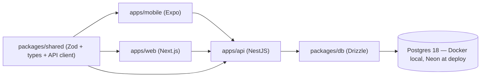

# Kosh — Build plan (phases)

Execution checklist for the monorepo. Product behavior and API contracts live in [Kosh — PRD.md](./Kosh%20%E2%80%94%20PRD.md) (tech stack table, schema, routes, screens).

**Progress (repo):** Phases 2–7 done on the API; Phase 1 partial (`apps/mobile` not scaffolded); Phase 8 web wiped (not started); Phases 9–10 pending.

## Overview

pnpm 12 + Turborepo 2 on Node 24 LTS (TypeScript 5.9). NestJS 12 API is the only writer to Postgres (Drizzle + Docker locally, Neon at deploy). Next.js 16 / React 19 web first; Expo SDK 58 mobile second. Shared Zod schemas in `packages/shared`.

## Locked decisions

- Postgres on Neon + Drizzle (no Supabase)
- Multi-session auth: one `sessions` row per device; access JWT carries `sub` + `sid`; list/revoke sessions
- Partial debt payments; auto-settle at zero; completed debts kept as history
- Email verification deferred (register → immediate login)
- Web before mobile; investment `currentValue` is manual mark-to-market; transaction lists use “Load more” (cursor pagination)

## Architecture

## Phases

| Phase | Focus                          | Status                                                       |
| ----- | ------------------------------ | ------------------------------------------------------------ |
| 1     | Monorepo scaffold              | **Partial** — api + packages + web exist; mobile not created |
| 2     | `packages/shared`              | **Done**                                                     |
| 3     | `packages/db` + local Postgres | **Done**                                                     |
| 4     | API: auth                      | **Done**                                                     |
| 5     | API: core domain               | **Done**                                                     |
| 6     | API: investments & debts       | **Done**                                                     |
| 7     | API: reports                   | **Done**                                                     |
| 8     | Web client                     | **Not started** — `apps/web` wiped; rebuild pending |
| 9     | Mobile client                  | Pending                                                      |
| 10    | Deploy                         | Pending                                                      |

### Phase 1 — Monorepo scaffold

- pnpm workspace + Turborepo at root; `apps/{api,web,mobile}`, `packages/{shared,db,config}`
- `packages/config`: shared tsconfig + ESLint flat config; root `turbo.json` (dev/build/lint/typecheck); `.env.example`
- Mobile: scaffold with `create-expo-app --template default@sdk-58` (dev build if store Expo Go lags SDK 58)

### Phase 2 — `packages/shared`

- Zod schemas for every entity in the PRD (auth, account, tag, transaction, investment types/transactions, contact, debt, debt payment, monthly report)
- Types via `z.infer`; typed API client for RTK Query on web and mobile

### Phase 3 — `packages/db` + local Postgres

- Drizzle schema for 10 tables: `users`, `sessions`, `accounts`, `tags`, `transactions`, `investmentTypes`, `investmentTransactions`, `contacts`, `debts`, `debtPayments` (every table has `userId`)
- Root `docker-compose.yml`: `postgres:18-alpine`, port 5436; `DATABASE_URL` in `.env` for local dev
- drizzle-kit migrations; postgres.js driver (same at Neon deploy)

### Phase 4 — API: auth (`apps/api`)

- Global Zod pipe; `JwtAuthGuard` + `userId` scoping on every handler
- `POST /auth/register`, `/login`, `/refresh`, `/logout`, `GET /auth/sessions`, `DELETE /auth/sessions/:id`
- Access JWT ~15 min (`sub` + `sid`); refresh hashed, rotated, reuse revokes session
- Refresh in httpOnly cookie and JSON body; CSRF on cookie routes; CORS `credentials: true`
- Rate limiting on auth (in-memory throttler; Redis later if needed)

### Phase 5 — API: core domain

- Accounts; transactions with filters (`accountId`, `tagId`, `from`, `to`) and cursor pagination
- Balance updates in DB transactions on create/patch/delete (expense, income, transfer including bank→cash)
- Tags CRUD (+ tag sort preferences / order per PRD)

### Phase 6 — API: investments & debts

- Investment types + transactions; `investedTotal` = invest − withdraw on read; `PATCH` `currentValue`
- Contacts; debts CRUD; `POST /debts/:id/payments`; auto `settled` + `settledAt` at zero; `GET /debts/:id` with payment history

### Phase 7 — API: reports

- `GET /reports/monthly?month=YYYY-MM`: category breakdown by tag, per-account net for the month, net-worth snapshot (liquid + investments − open debts you owe), open debts grouped by contact

### Phase 8 — Web client (first)

- Next.js App Router + RTK Query + PRD design tokens (light/dark, signed colored amounts)
- Screens: auth → first-run setup → Home → Add expense/income → Transactions → Investments → Debt balance → Settings (accounts, tags, investment types, sessions) → `/reports/monthly`

### Phase 9 — Mobile client

- Expo; same screens as web except monthly report; refresh token in secure storage

### Phase 10 — Deploy

- Neon Postgres 18 (free tier); production `DATABASE_URL`
- API → Fly.io (migrate on release); web → Vercel; mobile → EAS Build

## Verification

- API e2e: refresh rotation/reuse, balance maintenance, debt auto-settle
- `pnpm typecheck` (turbo) green before calling a phase done

## Post-v1 (parked)

- Shared spaces / partner visibility and split expenses
- Email verification (Resend/SES)
- Redis (cache, distributed rate limits, job queue backing)
- Recurring transactions, budgets, bank/SMS import (needs background jobs)
